# ⚽ Futbolio: Serie A Futbol Uygulaması

İtalya Serie A için **haftalık fikstür**, **dinamik puan durumu**, **maç detayı** (goller, kartlar,
oyuncu değişiklikleri) ve **Türkçe yönetim paneli** sunan bir ASP.NET Core uygulaması.
Aynı solution içinde iki proje vardır: veritabanına erişen **Web API** ve bu API'yi tüketen **MVC arayüzü**.


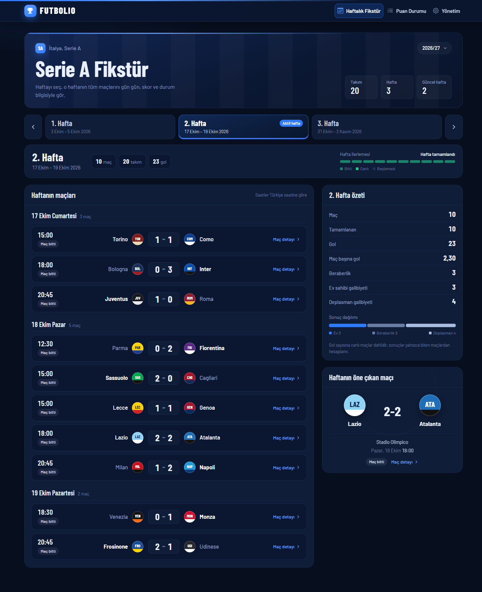

## İçindekiler

- [Özellikler](#özellikler)
- [Case gereksinimleri](#case-gereksinimleri)
- [Ekran görüntüleri](#ekran-görüntüleri)
- [Mimari](#mimari)
- [Veri modeli](#veri-modeli)
- [Kurulum ve çalıştırma](#kurulum-ve-çalıştırma)
- [API uç noktaları](#api-uç-noktaları)
- [İş kuralları](#iş-kuralları)
- [Test](#test)
- [Proje yapısı](#proje-yapısı)

---

## Özellikler

**Kullanıcı ekranları**

- **Haftalık fikstür:** Hafta seçilir, o haftanın maçları gün gün listelenir. Haftanın özeti
  (gol sayısı, sonuç dağılımı) ve öne çıkan maç gösterilir. Hafta değiştirince sayfa yenilenmez.
- **Puan durumu:** Ayrı bir tablo tutulmaz; puanlar her istekte **tamamlanan maçlardan** hesaplanır.
  Sıralama puan → averaj → atılan gol. Son 5 maç formu, puan dağılımı şeridi ve bölge filtreleri vardır.
- **Maç detayı:** Skor, ilk yarı skoru, gol atanlar, kartlar, oyuncu değişiklikleri ve dakika dakika maç akışı.

**Yönetim paneli** (`/Admin`, Türkçe, sidebar'lı)

- **Ana sayfa:** Lig özeti, son sonuçlar, puan durumunda ilk 5, sıradaki maçlar.
- **Maçlar:** Listeleme, filtreleme, ekleme, düzenleme, silme. Maç detayında **gol, kart ve oyuncu
  değişikliği** ekleme, düzenleme, silme.
- **Takımlar:** Takım ekleme, düzenleme, silme (maçı olan takım silinemez).
- **Haftalar:** Her haftanın durumu; eksik maç ya da aynı hafta iki maça konmuş takım varsa uyarı.
- **Puan durumu:** Yönetici için salt okunur tablo.

**Diğer**

- İlk açılışta veritabanı kendiliğinden kurulur ve **örnek veriler** eklenir: 20 takım, 3 hafta × 10 maç,
  gol/kart/değişiklik kayıtlı 3 maç.
- Tek komutla çalışan **60 kontrollük uçtan uca test**.
- Telefon ekranına uyumlu tasarım.

## Case gereksinimleri

Bootcamp case dokümanındaki (Serie A Futbol Uygulaması) maddelerin projede nerede karşılandığı:

| Gereksinim | Durum | Projede |
|---|:-:|---|
| Aynı solution'da ayrı API ve WebUI projeleri | ✅ | `Futbolio.API` + `Futbolio.WebUI` (case'teki `SerieA.API` / `SerieA.WebUI` karşılığı) |
| UI veritabanına doğrudan erişmez, her şey API'den | ✅ | WebUI'da DbContext yok; okumalar `FootballDataService`, kayıtlar admin controller'ları ile API'ye gider |
| EF Core + SQL Server, tek katman | ✅ | `ApiContext`, migration'lar, ekstra servis/repository katmanı yok |
| API: Controllers · Entities · Context · DTOs | ✅ | `Futbolio.API/` klasör yapısı |
| WebUI: Controllers · Views · ViewModels | ✅ | `Futbolio.WebUI/` klasör yapısı |
| Tablolar: Team, Match, MatchGoal, MatchCard, Substitution | ✅ | `Entities/`, oyuncu tablosu yok, isimler metin |
| 20 takım, en az 3 hafta, haftada 10 maç, en az 30 maç | ✅ | `SeedData`: 20 takım, 3 hafta × 10 maç = 30 maç |
| En az 3 detaylı maç | ✅ | Inter-Milan, Roma-Lazio, Napoli-Juventus (gol sayıları skorla tutarlı) |
| Puan durumu dinamik, ayrı standings tablosu yok | ✅ | `GET /api/standings` her istekte hesaplar |
| G 3 · B 1 · M 0; sıralama Puan → Averaj → Atılan gol | ✅ | `StandingsController` |
| Haftalık fikstür, seçilen haftanın 10 maçı | ✅ | `/Fixtures` + `GET /api/matches/week/{week}` |
| Maç detayı: skor, gol dakikaları, kartlar, değişiklikler | ✅ | `/MatchDetail/Index/{id}` + `GET /api/matches/{id}` |
| Sidebar'lı Türkçe admin paneli, maç CRUD | ✅ | `/Admin/Matches` (+ gol, kart, değişiklik, takım CRUD) |
| Ev sahibi ≠ deplasman | ✅ | API `CheckMatch` → 400 |
| Takım aynı hafta tek maç | ✅ | API `CheckMatch` → 400 |
| Puana sadece **Tamamlandı** maçlar girer | ✅ | `Status == Completed` filtresi |
| Averaj = Atılan − Yenilen | ✅ | `GoalDifference = GoalsFor - GoalsAgainst` |
| Gol/kart/değişiklik geçerli bir maça bağlı | ✅ | FK + `CheckMatchAndTeam` → olmayan maç 404, yanlış takım 400 |
| Bulunamayan / silinmiş kayıtta uygun HTTP cevabı | ✅ | 404 `NotFound`, kural ihlalinde 400 |

## Ekran görüntüleri

### Puan durumu

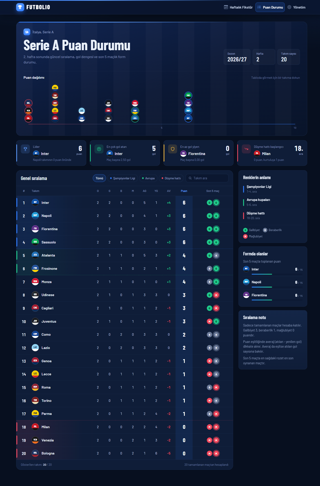

### Maç detayı

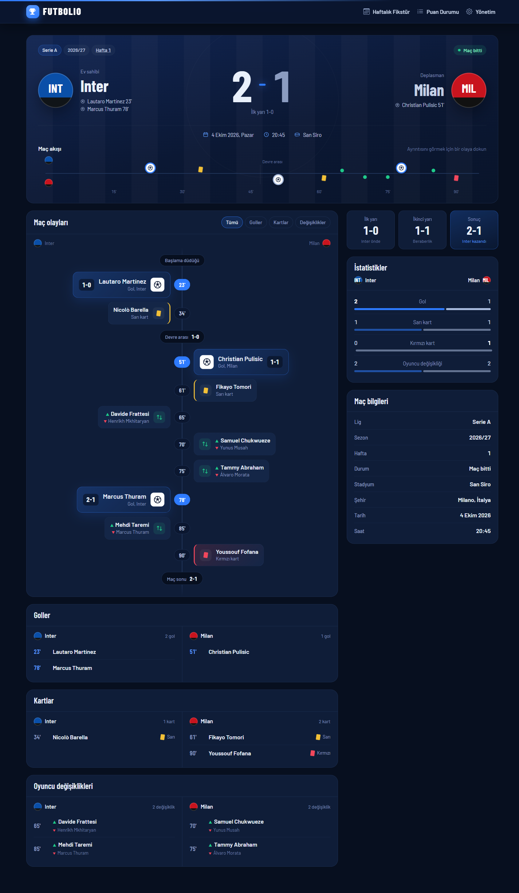

### Telefonda

<p>
  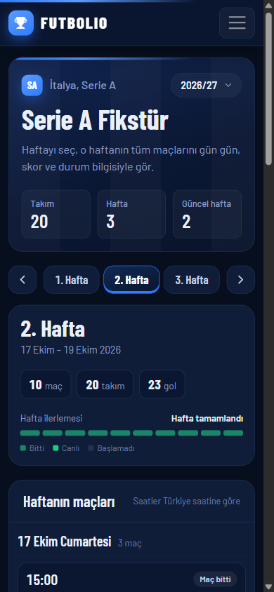
  &nbsp;&nbsp;
  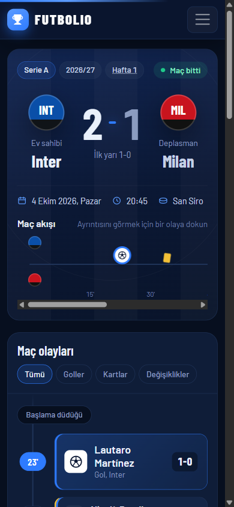
</p>

### Yönetim paneli

| Ana sayfa | Maçlar |
|---|---|
| 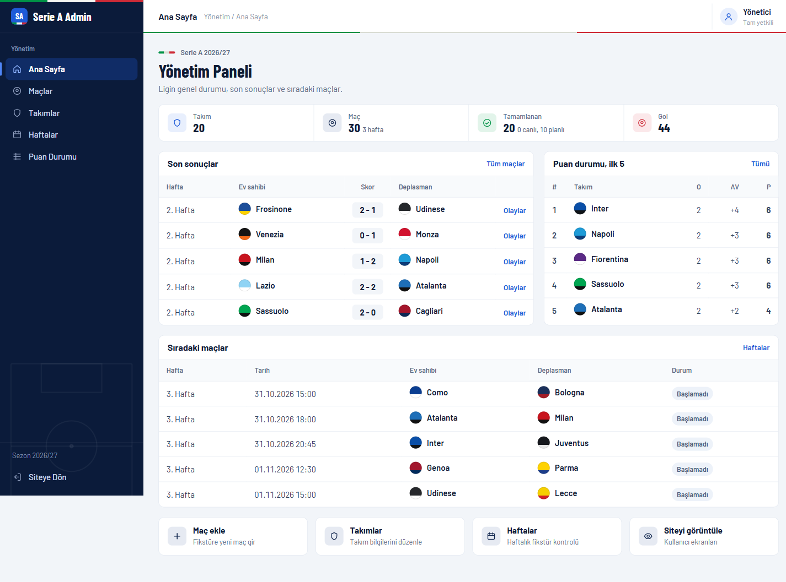 | 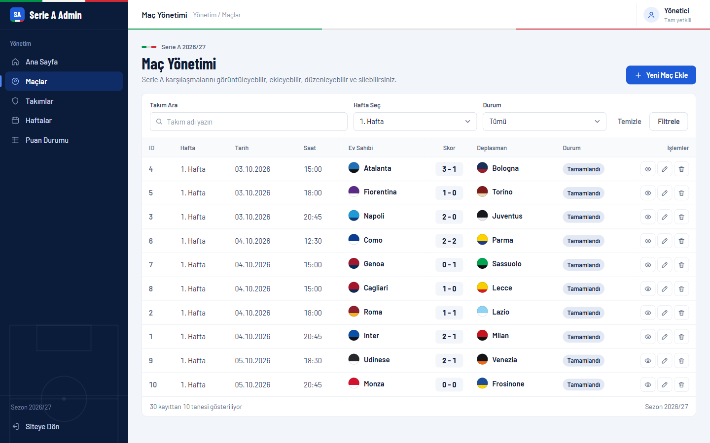 |
| **Maç detayı: gol, kart, değişiklik** | **Gol ekleme** |
| 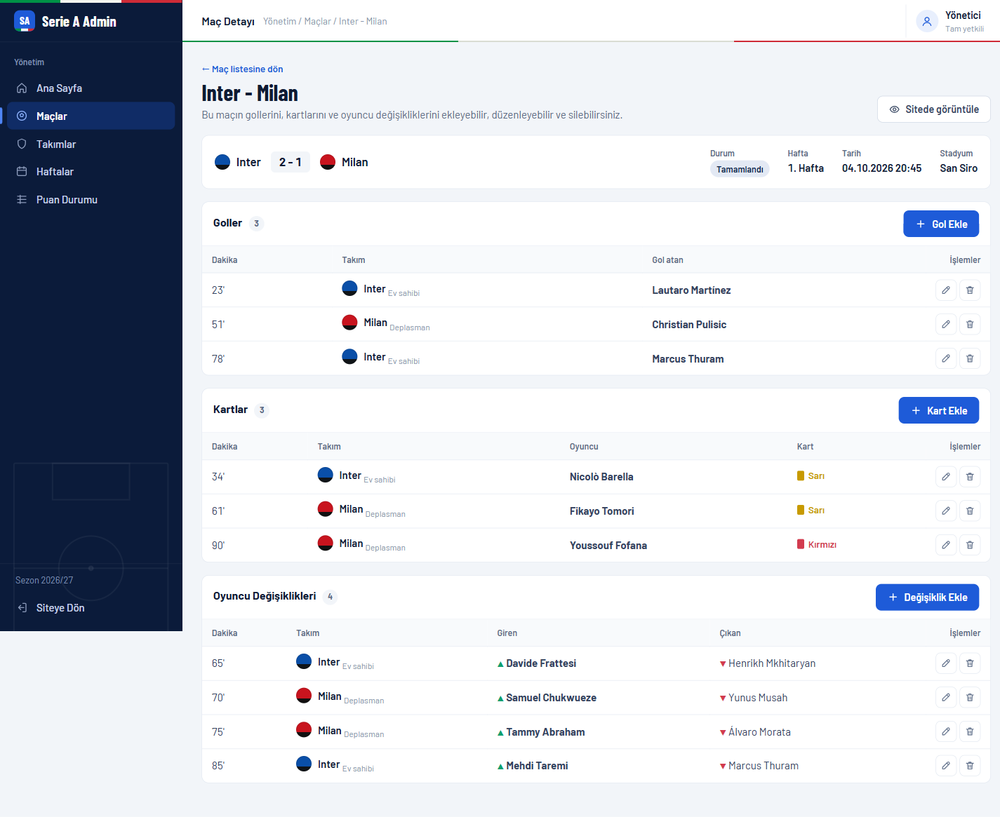 | 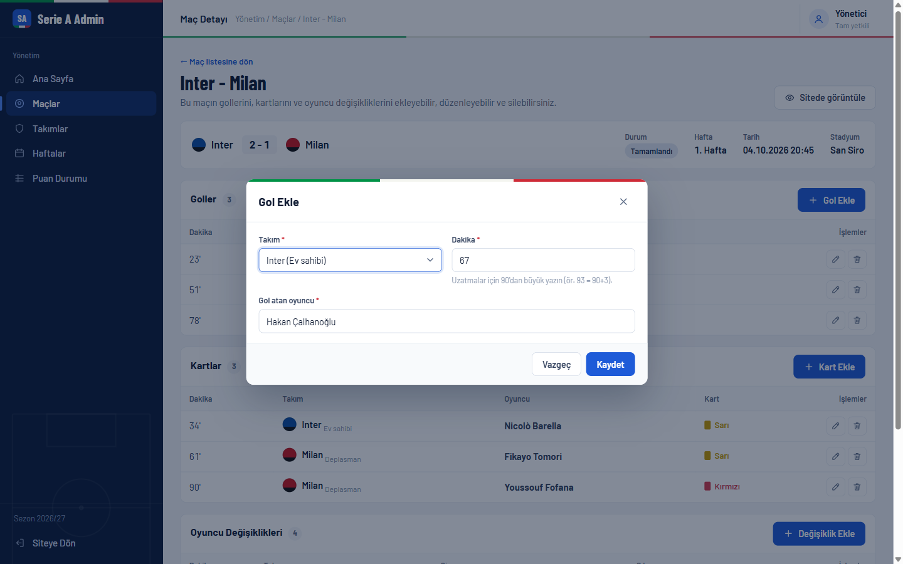 |

**Haftalar:** her hafta için maç sayısı, durum ve fikstür kurallarına uygunluk.

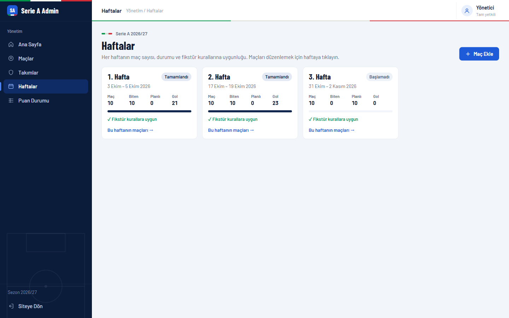

## Mimari

Tarayıcı veritabanını ve API'yi hiç görmez. Her şey WebUI üzerinden geçer, WebUI de verileri sadece API'den alır.

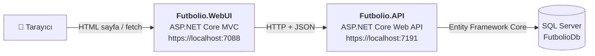

| Katman | Sorumluluk |
|---|---|
| **Futbolio.API** | Veritabanına erişen tek proje. Tüm iş kuralları, puan hesabı, CRUD uç noktaları |
| **Futbolio.WebUI** | Sayfalar ve yönetim paneli. Okumalar `IFootballDataService`, kayıtlar admin controller'ları üzerinden API'ye gider |
| **SQL Server** | 5 tablo: Teams, Matches, MatchGoals, MatchCards, Substitutions |

### Örnek akış: yönetim panelinden gol eklemek

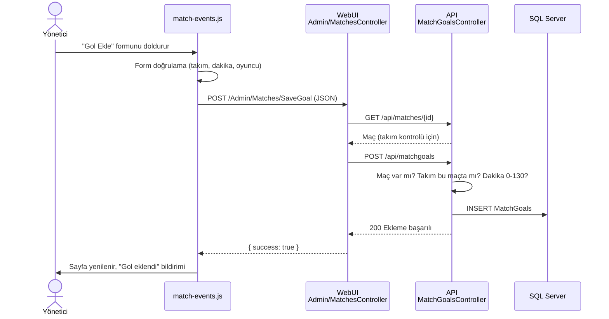

## Veri modeli

Oyuncu tablosu yoktur; maç olaylarında oyuncu adları metin olarak tutulur.

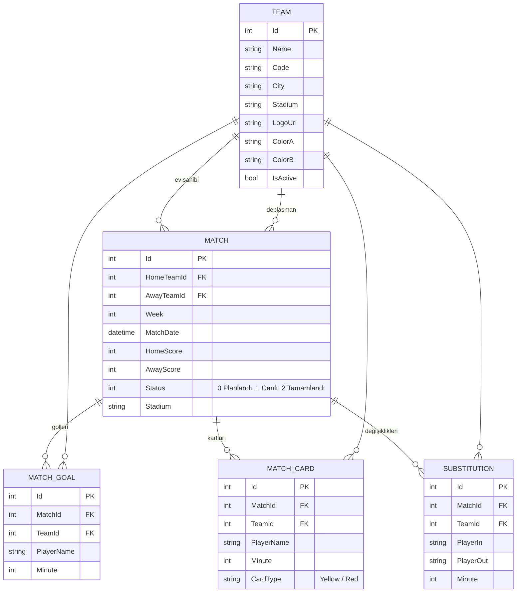

Maç silinince golleri, kartları ve değişiklikleri de silinir (cascade). Maçı olan takım silinemez (restrict).

## Kurulum ve çalıştırma

### Gerekenler

- [.NET 8 SDK](https://dotnet.microsoft.com/download/dotnet/8.0)
- SQL Server (Express yeterli)
- Visual Studio 2022+ ya da `dotnet` komut satırı

### 1. Bağlantı cümlesi

`Futbolio.API/appsettings.json` içinde `DefaultConnection`'ı kendi SQL Server'ına göre ayarla:

```json
"ConnectionStrings": {
  "DefaultConnection": "Server=.\\SQLEXPRESS;Database=FutbolioDb;Trusted_Connection=True;TrustServerCertificate=True;"
}
```

### 2. Önce API, sonra WebUI

```bash
dotnet run --project Futbolio.API --launch-profile https
```

```bash
dotnet run --project Futbolio.WebUI --launch-profile https
```

API ilk açılışta veritabanını oluşturur, migration'ları uygular ve **Teams tablosu boşsa** örnek verileri ekler.
Ayrıca `dotnet ef database update` çalıştırmana gerek yoktur.

> **Visual Studio'da:** Solution'a sağ tık → *Configure Startup Projects* → *Multiple startup projects* →
> ikisini de *Start* yap, API üstte olsun.

### 3. Adresler

| Sayfa | Adres |
|---|---|
| Haftalık fikstür (ana sayfa) | https://localhost:7088/Fixtures |
| Puan durumu | https://localhost:7088/Standings |
| Maç detayı | https://localhost:7088/MatchDetail/Index/1 |
| Yönetim paneli | https://localhost:7088/Admin |
| API dokümantasyonu (Swagger) | https://localhost:7191/swagger |

WebUI'ın hangi API'ye bağlanacağı `Futbolio.WebUI/appsettings.json` → `ApiSettings:BaseUrl` ayarındadır.

## API uç noktaları

| Kaynak | Uç noktalar |
|---|---|
| **Takımlar** | `GET /api/teams` · `GET /api/teams/{id}` · `POST` · `PUT /{id}` · `DELETE /{id}` |
| **Maçlar** | `GET /api/matches` · `GET /api/matches/week/{week}` · `GET /api/matches/{id}` (goller, kartlar, değişikliklerle) · `POST` · `PUT /{id}` · `DELETE /{id}` |
| **Goller** | `GET /api/matchgoals/match/{matchId}` · `GET /{id}` · `POST` · `PUT /{id}` · `DELETE /{id}` |
| **Kartlar** | `GET /api/matchcards/match/{matchId}` · `GET /{id}` · `POST` · `PUT /{id}` · `DELETE /{id}` |
| **Oyuncu değişiklikleri** | `GET /api/substitutions/match/{matchId}` · `GET /{id}` · `POST` · `PUT /{id}` · `DELETE /{id}` |
| **Puan durumu** | `GET /api/standings` |

Bulunamayan kayıtlar için `404`, kural ihlallerinde açıklamalı `400` döner.

## İş kuralları

| Kural | Nerede |
|---|---|
| Ev sahibi ve deplasman takımı aynı olamaz | API `MatchesController.CheckMatch` |
| Bir takım aynı hafta birden fazla maçta yer alamaz | API `MatchesController.CheckMatch` · Admin Haftalar uyarısı |
| Puan durumuna yalnızca **Tamamlandı** durumundaki maçlar girer | API `StandingsController` |
| Galibiyet 3, beraberlik 1, mağlubiyet 0 puan | API `StandingsController` |
| Averaj = atılan gol − yenilen gol; sıralama puan → averaj → atılan gol | API `StandingsController` |
| Gol, kart ve değişiklik geçerli bir maça ve o maçın takımına bağlı olmalı | API `CheckMatchAndTeam` + WebUI ön kontrolü |
| Dakika 0–130 arası; kart tipi Sarı/Kırmızı; giren ≠ çıkan oyuncu | API + WebUI |

## Test

Uçtan uca test, uygulamayı gerçek bir kullanıcı gibi dener: sayfaları açar, yönetim panelinden kayıt
ekler, düzenler, siler ve sonucu API'den kontrol eder (60 kontrol). Asıl veritabanına dokunmaz; ayrı bir
test veritabanı kurar ve iş bitince siler. Python 3 ve `sqlcmd` gerekir.

```bash
powershell -ExecutionPolicy Bypass -File .\Tests\run-e2e.ps1
```

```
==> Testler çalışıyor
OK    Örnek veri: 20 takım
OK    Örnek veri: 1. hafta 10 maç, takım tekrarı yok
OK    Kural: takım aynı hafta ikinci maça konamaz
OK    Puan durumu: tamamlanan maç kazanana +3 ekledi
OK    Gol: Türkçe karakterli isim doğru kaydedildi
OK    Maçın kartı ve değişikliği de silindi (cascade)
...
60/60 test geçti
TÜM TESTLER GEÇTİ
```

Ayrıntılar: [ACIKLAMALAR.md → Uçtan uca test](ACIKLAMALAR.md#7-uçtan-uca-test)

## Proje yapısı

```
Futbolio.slnx
├── Futbolio.API/                 Web API (veritabanına erişen tek proje)
│   ├── Context/                  ApiContext (EF Core) + SeedData (örnek veriler)
│   ├── Controllers/              Teams, Matches, MatchGoals, MatchCards, Substitutions, Standings
│   ├── DTOs/                     API'nin aldığı ve döndürdüğü veri şekilleri
│   ├── Entities/                 Veritabanı tabloları
│   ├── Mapping/                  AutoMapper profili
│   └── Migrations/
├── Futbolio.WebUI/               MVC arayüzü (veriyi API'den alır)
│   ├── Areas/Admin/              Yönetim paneli (controller'lar + view'lar)
│   ├── Controllers/              Fixtures, Standings, MatchDetail
│   ├── Services/                 FootballDataService (API'den okuma)
│   ├── Helpers/                  TeamStyle (arma, durum, dakika yazımı)
│   ├── ViewModels/
│   ├── Views/
│   └── wwwroot/                  css + js (her sayfanın kendi dosyası)
├── Tests/                        Uçtan uca test (run-e2e.ps1 + e2e_test.py)
├── docs/images/                  README ekran görüntüleri
├── ACIKLAMALAR.md                Kodun ve kavramların ayrıntılı açıklaması
└── README.md
```

> Kodu ilk kez okuyorsan önce [ACIKLAMALAR.md](ACIKLAMALAR.md)'ye bak. Bir isteğin adım adım yolculuğu,
> hangi dosyanın ne yaptığı ve kodda geçen kavramlar (DI, async/await, fetch, `<dialog>` …) orada anlatılıyor.

